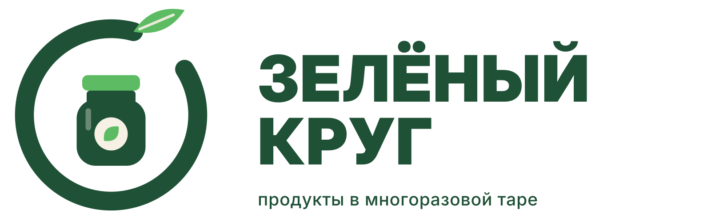

# Зелёный Круг — айдентика бренда

Учебный проект по компьютерной графике (практические 11–12): фирменный стиль и цифровое присутствие вымышленной компании **«Зелёный Круг»**, сервиса доставки продуктов в многоразовой стеклянной таре.

**Концепция:** разомкнутое кольцо показывает путь тары по кругу (доставили → вернули → помыли → наполнили). Из кольца вырастает лист — забота о природе. Внутри стоит многоразовая банка.

## Что внутри

| Папка | Содержимое |
|---|---|
| [`presentation/`](presentation) | Итоговая презентация `.pptx` (16 слайдов, видео и гифки встроены) |
| [`docs/`](docs) | Макет сайта: главная страница (desktop), мобильная версия, UI-кит, мудборд — HTML/CSS/JS |
| [`brand/logo/`](brand/logo) | Логотип: горизонтальный, вертикальный, favicon, аватар, монохром (SVG + PNG) |
| [`brand/mascot-3d/`](brand/mascot-3d) | 3D-талисман Кругляш: рендеры и гифка поворота |
| [`brand/ui/`](brand/ui) | Скриншоты сайта, UI-кита и мудборда |
| [`brand/video/`](brand/video) | Рекламный ролик, 24 с, 1080p |
| [`brand/gif-stickers/`](brand/gif-stickers) | GIF-анимации и стикерпак |
| [`brand/mockups/`](brand/mockups) | Визитка и фирменный бланк, мокапы |
| [`brand/packaging/`](brand/packaging) | 3D-упаковка, развёртки этикеток |
| [`brand/patterns/`](brand/patterns) | Фирменные паттерны |
| [`brand/illustrations/`](brand/illustrations) | Иллюстрации и иконки |
| [`tools/`](tools) | Скрипты, которыми сгенерирована графика (Python, Node.js) |

## Палитра

| Цвет | HEX | Роль |
|---|---|---|
| Хвойный | `#1F5136` | основной, фоны, логотип |
| Свежая зелень | `#5DBB63` | свежесть, акценты, иконки |
| Льняной | `#F6F1E4` | светлые фоны, этикетки |
| Тыквенный | `#F4A93B` | кнопки CTA, промо |

Шрифты: **Inter Display Black** для заголовков, **Inter** для текста.

## Как посмотреть сайт

Откройте `docs/index.html` в браузере. Мобильная версия — `docs/mobile.html`, UI-кит — `docs/uikit.html`. Если в репозитории включены GitHub Pages (Settings → Pages → ветка `main`, папка `/docs`), сайт будет доступен по ссылке.

## Талисман

**Кругляш** — добродушная стеклянная банка с ростком на крышке. Помнит каждую банку «в лицо» и радуется, когда она возвращается домой.
